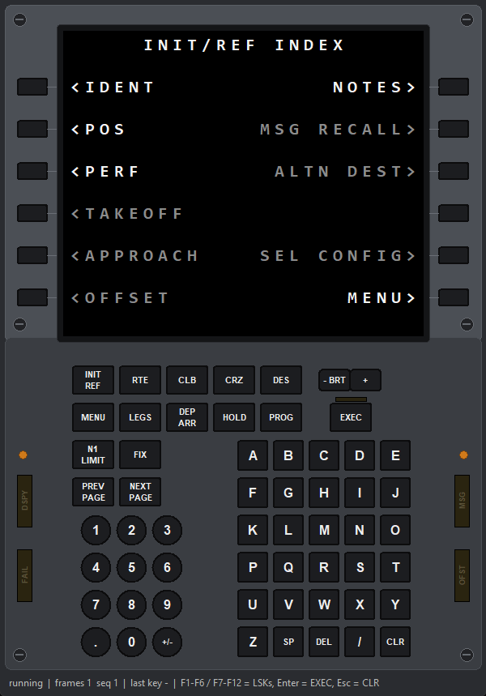
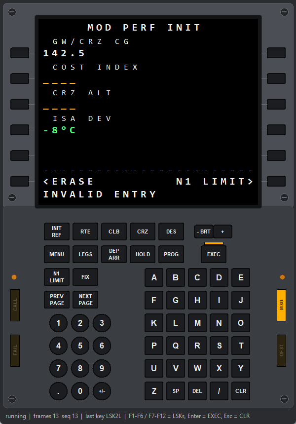

# moza_fcd

A standalone Python driver for the MOZA FCD flight computer display (MA3F Airbus MCDU / MB7F Boeing CDU). It puts your own text on the 5.1" screen without MOZA Cockpit or MobiFlight, and reads its keys, light sensors and status lights. A few ready-made apps are included (see [Apps in this repo](#apps-in-this-repo)).

MIT licensed (see [LICENSE](LICENSE)). It's a port of MobiFlight's open-source `MobiFlightMoza` library (also MIT, see [NOTICE](NOTICE)), which was written from MOZA's partner protocol guide and tested on a real **MA3F**. This port has been tested on a real **MB7F** (PID `0x1306`, firmware 1.2.7.30); see [What's verified](#whats-verified).

> **Created with AI.** This project (code, tests, protocol notes and documentation) was developed with an AI coding assistant, Anthropic's Claude Code, working with the repo owner. Behaviour was tested on real hardware where noted under [What's verified](#whats-verified); everything else is unverified. Review the code before relying on it.

> **Not affiliated with or endorsed by MOZA Racing (Gudsen).** MOZA, the FCD names and the aircraft names belong to their owners. Use at your own risk. The driver only uses the documented screen protocol and commands verified on hardware; it never updates firmware.

## Quick start

```bash
pip install -r requirements.txt            # the driver needs only pyserial (keys use Windows' built-in HID API)
pip install -r requirements-apps.txt       # optional: what the apps in apps/ need
python -m moza_fcd gui                     # no hardware: desktop CDU emulator running the demo app
python -m moza_fcd gui --app examples/my_app.py
python -m moza_fcd demo --port sim         # no hardware: simulated device, drawn in the terminal
python -m moza_fcd list                    # with hardware: find the FCD's COM port / PID
python -m moza_fcd run --app examples/my_app.py   # with hardware: the same app on the real screen + keys
python -m moza_fcd hid                     # with hardware: watch key presses (MB7F key names)
python -m moza_fcd lights --set EXEC=on    # with hardware: status lights
python -m unittest discover -s tests       # golden byte vectors, simulated end-to-end, app framework, the apps
```

**Close MOZA Cockpit first.** It holds the serial port while it runs.

## Desktop emulator

 

`python -m moza_fcd gui` opens a window laid out like the MB7F:
- the screen
- line select keys 1L–6R
- function keys and the BRT rocker
- EXEC with its light bar
- number pad and alpha keys
- the CALL / FAIL / MSG / OFST status lights

**Your app talks to the simulated device over the full serial protocol, exactly as it would to hardware.** The window draws whatever the simulated device received, so wire-level mistakes show up here too.

**Input:** click the keys or use the PC keyboard:

| PC key | CDU key |
|---|---|
| letters, digits, `.`, `/` | type |
| Space | SP |
| `-` | +/- |
| Backspace / Esc | CLR (hold to clear the whole scratchpad) |
| Delete | DEL |
| Enter | EXEC |
| PgUp / PgDn | PREV / NEXT PAGE |
| F1–F6 | LSK 1L–6L |
| F7–F12 | LSK 1R–6R |

The status bar shows session state, frames received, and the last key.

**What it can't show:**
- The device's own UI (display mode 0) isn't simulated.
- Status lights reach the simulated device as the same main-board commands sent to hardware.
- Fonts are approximated with Consolas.

## Writing apps

An app is a file with a `main(screen)` function. The same file runs in the emulator (`gui --app`) and on hardware (`run --app`). [moza_fcd/app.py](moza_fcd/app.py) handles the CDU conventions:
- six label/data lines per page, next to the LSKs
- a scratchpad with CLR, CLR-hold and DEL ("DELETE")
- page counts with PREV/NEXT ("1/2")
- function keys that jump to pages
- MOD titles and the EXEC light while changes are pending
- MSG light while a scratchpad message is showing

```python
from moza_fcd.app import CduApp, CduPage

class Home(CduPage):
    title = "MY APP"
    def draw(self, app, pg):
        app.line(pg, 1, "HELLO", "WORLD>", left_label="GREETING", color="green")
    def on_lsk(self, app, side, n):          # side 'L'/'R', n 1-6
        if app.scratchpad:
            app.show_message(f"GOT {app.take_scratchpad()}")
        return True

def main(screen):
    CduApp(screen, home="home", function_keys={"MENU": "home"}).add("home", Home()).run()
```

Examples:
- [examples/my_app.py](examples/my_app.py): a starter template.
- [moza_fcd/demo_app.py](moza_fcd/demo_app.py): the built-in demo. It has the INIT/REF INDEX from the reference photo, plus IDENT, POS (live clock, two pages), PERF (field validation, MOD/EXEC/ERASE), NOTES and KEY TEST.

Key names are in [moza_fcd/keys.py](moza_fcd/keys.py) (`LSK1L`, `EXEC`, `INIT_REF`, `A`, `+/-`, ...). Key events arrive through `screen.on_key(name, pressed)`: from the emulator in the sim, and from the device's HID buttons on hardware (`run` starts the reader automatically; see [Keys, sensors and lights](#keys-sensors-and-lights)).

### Without the framework

```python
from moza_fcd import FcdScreen, Page

with FcdScreen() as screen:                # or port="COM7", port="sim", product_ids=[0x....]
    screen.wait_ready()                    # handshake + ~4 s settings window
    page = Page()
    page.center(0, "MY APP", "cyan")
    page.write(2, 0, "ALT", small=True).right(2, "FL350", "green")
    screen.show(page)                      # first call sends a keyframe, later calls send only changed rows
    ...
    screen.set_display_mode(0)             # optional: hand the screen back to the device's own UI
```

## The screen model

- **14 rows × 24 columns** of characters. Text is sent as UTF-8; the device draws it with its own fonts.
- **Each cell has a style byte.** Bit 7 picks large (1) or small (0) text. Bits 3–0 pick one of 8 colours:

  | Code | Colour | Code | Colour |
  |---|---|---|---|
  | 1 | cyan | 5 | magenta |
  | 2 | red | 6 | amber |
  | 3 | yellow | 7 | white |
  | 4 | green | 8 | grey (see below) |

  `Page.write()` accepts these names, WinWing letters (`w c r y g m a e`), or raw codes 0–15. Code 0 and bits 6–4 are untested.

  The codes pick the device's text colours 1–8, which the user sets in MOZA Cockpit (Color Settings). **Confirmed on an MB7F with Cockpit's default colours:**
  - **Screen firmware 1.2.7.32 and newer:** codes 8–15 draw Text Color 9 (Cockpit's grey for unavailable options), so `"grey"` works.
  - **Older screen firmware (1.2.7.30 and before):** code 8 is Text Color 8, black by design ("fonts that would otherwise appear as black"), so grey text is invisible; codes 9–15 repeat colours 1–7.
  - Code 0 draws nothing on both.

  On older firmware, call `remap_color("grey", "white")` (or another colour) at startup, or update the screen firmware in MOZA Cockpit. Don't change Text Color 8 in Cockpit: aircraft CDUs rely on it being black.
- **No pixel or bitmap drawing exists.** Anything graphical has to be built from characters.
- `Page.from_winwing_json()` / `FcdScreen.show_winwing_json()` accept the WinWing/MobiFlight CDU JSON format, so existing CDU scripts can feed it.

## Layout

| File | What it is |
|---|---|
| `moza_fcd/protocol.py` | Pure encoders/decoders: framing, tunnel, Reliable Stream, MCDU frames, settings |
| `moza_fcd/session.py` | Pure state machines: stream connections and retransmits, settings/telemetry/MCDU channels, bring-up sequence. Driven by explicit `now` values, so it's fully testable. |
| `moza_fcd/device.py` | `FcdScreen`: pyserial transport, background thread, periodic keyframe refresh |
| `moza_fcd/page.py` | `Page` / `Cell` drawing API |
| `moza_fcd/sim.py` | `SimulatedFcd`: the device side of the protocol, for tests and hardware-free development |
| `moza_fcd/buttons.py` | `FcdKeyReader`: device keys and light sensors -> key names |
| `moza_fcd/hidwin.py` | Windows HID access via `hid.dll` (ctypes, no dependencies) |
| `moza_fcd/sdk.py` | Experimental ctypes binding to the official `MOZA_SDK.dll` |
| `moza_fcd/gui.py` | Desktop CDU emulator (tkinter) |
| `moza_fcd/app.py` | CDU app framework (pages, LSKs, scratchpad, EXEC) |
| `moza_fcd/keys.py` | Canonical key and light names, PC keyboard map |
| `moza_fcd/demo_app.py` | Built-in demo app |
| `examples/` | `hello.py`, `dashboard.py` (both accept `sim`), `my_app.py` (app template) |

## Protocol summary

```
USB CDC serial, 2,000,000 baud, DTR asserted.

SerialLink frame:  7E | Len | Cmd | DevicePair | Payload(<=64) | Checksum
                   checksum = (0x0D + 0x7E + sum of bytes) & 0xFF; 0x7E in the body is sent as 7E 7E (counted twice)
                   host -> device pair 0x12, device -> host pair 0x21

Bring-up:          host 7E 00 00 12 9D  ->  device 7E 00 80 21 2C   (root handshake)
                   host 7E 01 43 12 00 E1                            (device init via the tunnel)

0x43 tunnel:       payload[0] = inner command (bit 7 = reply); inner 0x7C = Reliable Stream

Reliable Stream:   a mini TCP. The DEVICE opens connections (SYN1) to service ports; the host answers SYN2.
                   Stop-and-wait: one TRANS (<=53 B data + CRC32) in flight, ACKs, 0.6 s retransmit,
                   3 s heartbeat (empty TRANS), FIN to close.

Service ports:     9010 telemetry   device sends a 4-byte token that must be echoed back
                   9020 settings    FF|Size|CRC32|Id|Data frames; time sync (0x02), protocol version (0x07),
                                    cabin position (0x13), display mode (0x18: 0 = device UI, 1 = MCDU)
                   9030 file xfer   used for font upload - NOT implemented (not public)
                   9050 MCDU        NetworkPackage(Id|Size u32|Payload): InitConfig 0x32 -> ClientCapability 0x33,
                                    then Keyframe 0x30 / Delta 0x31 (text + style rows, zlib when it helps,
                                    strictly increasing sequence numbers)

Main board:        plain SerialLink frames on the same port: Cmd = group, payload = ids + args
                   (encodings from the command library inside MOZA_SDK.dll). Replies: Cmd | 0x80.
                   lights     45 | 62 index on/off        keys/lamps  45 | 52 group 0-15 (+ 45 | 51 group 0)
                   reads      44 | id group -> reply C4 [id, group, value]   firmware log: Cmd 0E
Screen brightness: screen-board setting 0x01 (u32 percent) on port 9020.
                   seat side  45 | 59 0/1                 auto-bright 45 | 58 0/1
```

## Finding your device

Both FCDs report the same PID on their CDC serial port and their HID interface, and auto-detect knows both:

| Model | VID:PID | HID name |
|---|---|---|
| MB7F (Boeing CDU) | `346E:1306` | `MOZA MB7F MFCD Display` (confirmed on hardware) |
| MA3F (Airbus MCDU) | `346E:1305` | from MobiFlight |

1. Run `python -m moza_fcd list` with the device plugged in and MOZA Cockpit closed.
2. Run `python -m moza_fcd demo -v`. Add `--pid 0xXXXX` or `--port COMn` for an unlisted model.
3. When no host is driving it, the FCD shows its own homepage (`HOST NOT CONNECTED`) and returns to it a moment after the app exits.

**Only send this protocol to the FCD.** MOZA wheelbases and other devices share VID 0x346E and also expose serial ports. That's why auto-detect only matches known FCD PIDs.

If bring-up stalls, the `-v` trace shows which step it reached:
- root handshake
- device init
- settings ready
- MCDU capability
- display mode

## Keys, sensors and lights

These come from the MOZA Cockpit install (`C:\Program Files (x86)\MOZA Cockpit`), which knows the MB7F as **"T23 CDU"**.

**Keys.** The 71 keys are ordinary HID joystick buttons. Cockpit's key-test page numbers them, and [keys.py](moza_fcd/keys.py) maps them:

| Buttons | Keys |
|---|---|
| 43–48 / 49–54 | LSK 1L–6L / 1R–6R |
| 57–61, 62–66 | INIT REF, RTE, CLB, CRZ, DES / MENU, LEGS, DEP ARR, HOLD, PROG |
| 71, 67–70 | EXEC, N1 LIMIT, FIX, PREV PAGE, NEXT PAGE |
| 56 / 55 | BRT − / BRT + |
| 13–42 | A–Y, then Z, SP, DEL, /, CLR |
| 1–12 | 1–9, `.`, 0, +/- |

`FcdKeyReader` reads them with Windows' own HID parser, so no report layout is guessed. It works while MOZA Cockpit runs too. `python -m moza_fcd hid` shows live presses. `--vid` lets you try it with any other game controller.

**Light sensors.** The two dots beside the keypad are ambient-light sensors. They report as HID axes Rx (A), Ry (B) and Z (A+B), 0–65535, through `FcdKeyReader(on_axis=...)`. `python -m moza_fcd run` feeds them to `screen.light_levels` / `screen.on_light`. They read 0 unless the device's **Photoresistor Switch** is on (MOZA Cockpit > FCD > Basic Settings; saved on the device). With it on, the device itself adjusts screen brightness: it scales the configured screen level by the ambient light, so `set_screen_brightness()` still works as the base level (confirmed on an MB7F). Key backlight and annunciators aren't affected.

**Status lights.** There are five. `FcdScreen.set_light()` sends `CD_LedEnable` on the screen's own serial port; the encoding comes from the SDK's command library. The numbering in `keys.LED_IDS` was scanned on a real MB7F:

| Index | 0 | 1 | 2 | 3 | 4 | 5–20 |
|---|---|---|---|---|---|---|
| Lamp | CALL | FAIL | EXEC | MSG | OFST | nothing |

**Brightness** (mapped by watching MOZA Cockpit's sliders; the device saves all three):

| Part | Method | Range | Mechanism |
|---|---|---|---|
| Screen | `set_screen_brightness()` / `screen_brightness()` | 0–100 % | Screen-board setting `0x01` (Cockpit's 0–15 slider × 100/15) |
| Key backlight | `set_key_backlight()` / `key_backlight()` | 0–15 | Main-board lighting group 1: manual mode, then range |
| Annunciators | `set_indicator_brightness()` / `indicator_brightness()` | 0–15 | Main-board lighting group 3: range |

Main-board group 2 (called "screen" in Cockpit's tables) ignores writes on this firmware. `set_brightness()` sets the telemetry/device-mode value, which has no visible effect in manual mode.

**Other main-board settings:**
- `set_lighting_mode()` (manual / telemetry / device)
- `query_device(ids)` for any main-board read, e.g. `protocol.device_read_ids(protocol.CMD_GET_INDICATOR_MODE, 1)`
- `on_device_log`: the firmware's debug log lines (parameter writes, heartbeats, unsupported commands)
- `set_cockpit_side()`
- `enable_light_sensor()`
- `send_device_command(protocol.CMD_*, args)` for anything else in the command library

**MOZA SDK route.** [sdk.py](moza_fcd/sdk.py) drives the same commands through DeviceService instead.
- Use it when MOZA Cockpit owns the device.
- Tested on MOZA rudder pedals: while an SDK client has a device open, DeviceService locks its serial port. So the SDK and `FcdScreen` can't drive the same device at once.
- `Moza_Initialize()` auto-starts `MOZADeviceService.exe` from the Cockpit install.

**More from Cockpit, not implemented yet:**
- **Hardware:** the screen is a separate board. It's the same hardware as MOZA's W17/W18/W20 wheel displays, and its firmware is encrypted.
- **Fonts:** custom fonts are a supported feature. Cockpit subsets `.ttf/.otf` with `subset_font.exe` and uploads them over port 9030. It also has a global glyph width/height.
- **Colours:** the 8 text-colour slots plus the background colour are remappable (setting `0x17`).
- **Position:** setting `0x1B` is the display position offset.

## What's verified

| Status | What |
|---|---|
| Byte-for-byte | Every encoder matches the known-good vectors in MobiFlight's tests (from MOZA's guide) |
| Round-trip | Session logic runs against `SimulatedFcd`: bring-up, keyframes/deltas, chunking, lost-frame retransmit, heartbeats, shutdown. The simulator is built from the same rules, so this proves internal consistency, not firmware compatibility. |
| **On a real MB7F** (firmware 1.2.7.30) | Full bring-up: handshake, device init, settings, MCDU mode, live page updates, clean exit. Auto-detect (PID `0x1306`). HID keys match the Cockpit-derived map (10 keys spot-checked). Status lights `CD_LedEnable`, numbering scanned. HID light-sensor axes present |
| Live-tested elsewhere | SDK binding on MOZA rudder pedals; the A350 radio panel app's MSFS link against MSFS 2024 |
| On a real MB7F, later | Screen, key-backlight and annunciator brightness (set and read back), main-board reads, firmware log channel |
| On a real MB7F, later still | `enable_light_sensor(on)` (the photoresistor switch, `[69, 88]` + 0/1; saved on the device, write-only). While off, the sensor readings freeze at their last value (they read 0 only if it has never been on) |
| Not tested on hardware | Cockpit side; the remaining 61 keys (mapped from Cockpit, same layout) |
| Unknown | Font upload format (9030); exact layout of settings `0x17` / `0x1B` - send them with `FcdScreen.request_setting()` at your own risk |

## Apps in this repo

| App | What it does |
|---|---|
| `apps/everyday/` | Everyday PC controls and info: dashboard, audio, media, system, clock/timers, launcher, tools, Windows controls, weather/METAR, SimBrief, Discord, brightness and idle dimming |
| `apps/a350_rmp/` | iniBuilds A350 radio management panel (MSFS, SimConnect) |
| `apps/pmdg737_cdu/` | PMDG 737 CDU (captain or F/O): screen, keys and lights from PMDG's SDK over SimConnect (needs the `[SDK]` broadcast lines in `737_Options.ini`) |
| `apps/ifly_cdu/` | iFly 737 MAX 8 captain CDU: screen, keys and lights, from the iFly EFB's local web server (port 8084) |
| `apps/fenix_mcdu/` | Fenix A320 MCDU (captain or F/O): screen from the Fenix GraphQL gateway (port 8083), keys via its `S_CDU<n>_KEY_*` L-vars over SimConnect, Airbus keys mapped onto the 737 keypad |
| `apps/bb757_cdu/` | BlueBird 757 captain CDU: the 757 pushes its screen to this app's WebSocket server (port 8320, MobiFlight's CDU interface); keys and lights via its L-vars over SimConnect |
| `apps/a220/` | Synaptic A220: the FCD as the A220's keypad (MKP keys via MobiFlight's WASM module), plus RADIO (VHF/NAV/XPDR) and FLIGHT (modes, selections, master alerts) pages |

Run any of them with `python -m moza_fcd run --app <path>`; each folder has a README. The everyday app reads its settings from `apps/everyday/config.toml`: copy `config.example.toml` to that name first (it's git-ignored because it can hold API secrets).

## Building apps with an AI assistant

`.claude/skills/moza-fcd-app/` is an agent skill for Claude Code: `SKILL.md` covers the app contract, the CduApp framework, keys, lights, testing and safety rules, and `reference.md` holds the protocol and hardware findings. Claude Code loads it automatically when you work in this repo. Both files are plain Markdown, so they're also a compact developer guide.

## Not included

- **MOZA's SDK and software.** `moza_fcd/sdk.py` (optional, experimental) loads `MOZA_SDK.dll` from the official MOZA SDK, which isn't redistributed here. Point `MOZA_SDK_DLL` at your copy. Nothing else needs it.
- **Third-party documents**, such as iniBuilds' A350 L-var list used for the radio panel app. Download them from the publisher.
- **Personal data.** Runtime files (`config.toml`, `settings.json`, `notes.json`, `discord_token.json`) and logs are listed in `.gitignore`.
